<div align="center">


<br/>


[Overview](#-overview) · [Topology](#-topology) · [Design](#-design-summary) · [Evidence](#-evidence-walkthrough) · [Results](#-test-results) · [Troubleshooting](#-troubleshooting-log) · [Limitations](#-known-limitations--next-steps)

</div>

---

## 📌 Overview

This lab connects an **HQ site** and a **Branch site** across a simulated internet using a **route-based IPsec/IKEv2 VPN** (a VTI tunnel), then secures management access to both gateways with **AAA backed by a FreeRADIUS server**.

The ISP router knows nothing about the private LANs. Every packet between the two sites, including the RADIUS requests that the Branch router sends to the HQ server, must travel inside the encrypted tunnel. The design is then tested the way real networks fail: **AAA server down**, **tunnel down**, and **recovery**.

**Highlights**

- Route-based site-to-site VPN: IKEv2, AES-256, SHA-256, DH group 14, pre-shared key
- Proof that the ISP sees only ESP, with no ping, SSH or RADIUS in clear text
- RADIUS authentication, exec authorization (privilege level sent by the server) and exec accounting
- Two server-side roles: `netadmin` (level 15) and `netops` (level 1)
- Local fallback so a dead AAA server or a dead tunnel never locks engineers out
- Failure and recovery tests with debug output as evidence

---

## 🗺️ Topology

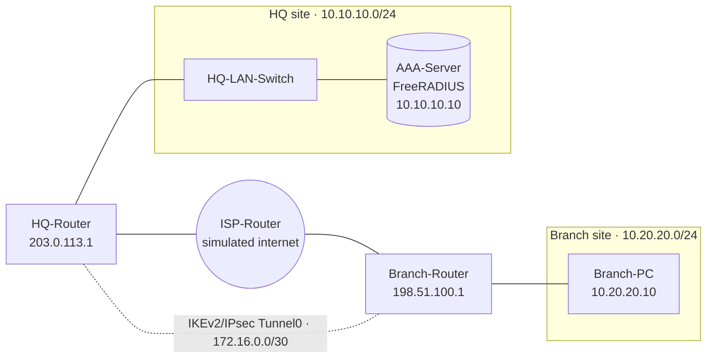

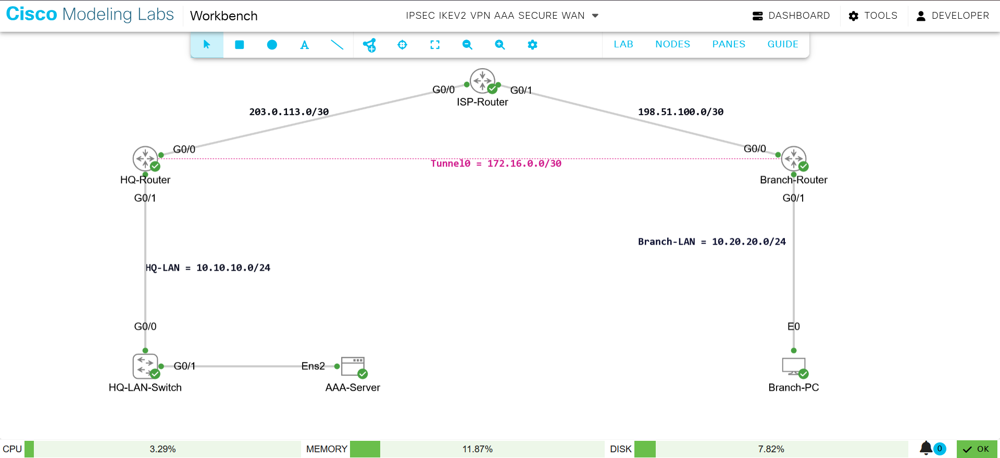
*Figure 1 – Full lab topology in Cisco CML, all nodes running.*

### Addressing

| Link / network | Side A | Side B |
|---|---|---|
| HQ-Router Gi0/0 ↔ ISP-Router Gi0/0 | `203.0.113.1/30` | `203.0.113.2/30` |
| Branch-Router Gi0/0 ↔ ISP-Router Gi0/1 | `198.51.100.1/30` | `198.51.100.2/30` |
| HQ LAN | HQ-Router Gi0/1 `10.10.10.1/24` | AAA-Server `10.10.10.10` |
| Branch LAN | Branch-Router Gi0/1 `10.20.20.1/24` | Branch-PC `10.20.20.10` |
| VPN tunnel (Tunnel0) | HQ `172.16.0.1/30` | Branch `172.16.0.2/30` |

### Lab environment

| Component | Platform |
|---|---|
| Simulator | Cisco Modeling Labs (CML) |
| Gateways and ISP | 3 × Cisco IOSv routers |
| HQ switch | Cisco IOSvL2 |
| AAA server | Ubuntu 24.04 with FreeRADIUS 3.x |
| Branch client | Linux node used for ping and SSH tests |

---

## 🔐 Design summary

| Area | Choice |
|---|---|
| VPN type | Route-based IPsec using a VTI (`Tunnel0`, `tunnel mode ipsec ipv4`) |
| IKE | IKEv2, AES-CBC-256, SHA-256, DH group 14, PSK authentication, 86400 s lifetime |
| IPsec | ESP with AES-256 and SHA-256 HMAC, tunnel mode |
| Routing | Static default route to the ISP on each gateway, static route to the remote LAN via the tunnel |
| MTU | Tunnel MTU 1400 and TCP MSS 1360 |
| Authentication | RADIUS first, then local (`VTY-LOGIN group RAD-GRP local`); console is local only |
| Authorization | Privilege level returned by the server (`Cisco-AVPair shell:priv-lvl=N`) |
| Accounting | Exec accounting, start-stop, sent to the RADIUS server |
| Roles | `netadmin` = level 15, `netops` = level 1, local `admin` = emergency fallback |
| Resilience | `dead-criteria time 5 tries 2` and `deadtime 2` so a dead server is skipped quickly |
| Scope | ISP-Router stays on local login only; it is not part of the customer network |

<details>
<summary><b>Key configuration (secrets removed)</b></summary>

**HQ-Router: IKEv2 and IPsec**
```text
crypto ikev2 proposal IKE-PROP
 encryption aes-cbc-256
 integrity sha256
 group 14
crypto ikev2 policy IKE-POL
 proposal IKE-PROP
crypto ikev2 keyring KEYRING
 peer BRANCH
  address 198.51.100.1
  pre-shared-key <PSK>
crypto ikev2 profile IKE-PROF
 match identity remote address 198.51.100.1 255.255.255.255
 identity local address 203.0.113.1
 authentication remote pre-share
 authentication local pre-share
 keyring local KEYRING
crypto ipsec transform-set TSET esp-aes 256 esp-sha256-hmac
 mode tunnel
crypto ipsec profile IPSEC-PROF
 set transform-set TSET
 set ikev2-profile IKE-PROF
interface Tunnel0
 ip address 172.16.0.1 255.255.255.252
 ip mtu 1400
 ip tcp adjust-mss 1360
 tunnel source GigabitEthernet0/0
 tunnel destination 198.51.100.1
 tunnel mode ipsec ipv4
 tunnel protection ipsec profile IPSEC-PROF
ip route 10.20.20.0 255.255.255.0 172.16.0.2
```

**HQ-Router: AAA** (the Branch-Router is the same, with its own LAN interface as the RADIUS source)
```text
aaa new-model
radius server AAA-SERVER
 address ipv4 10.10.10.10 auth-port 1812 acct-port 1813
 key <RADIUS_SECRET>
 timeout 3
 retransmit 1
aaa group server radius RAD-GRP
 server name AAA-SERVER
ip radius source-interface GigabitEthernet0/1
radius-server dead-criteria time 5 tries 2
radius-server deadtime 2
aaa authentication login VTY-LOGIN group RAD-GRP local
aaa authentication login CON-LOGIN local
aaa authorization exec VTY-EXEC group RAD-GRP local
aaa accounting exec default start-stop group RAD-GRP
line vty 0 4
 login authentication VTY-LOGIN
 authorization exec VTY-EXEC
line con 0
 login authentication CON-LOGIN
```

**AAA-Server: FreeRADIUS**
```text
# /etc/freeradius/3.0/clients.conf
client HQ-Router     { ipaddr = 10.10.10.1   secret = <RADIUS_SECRET> }
client Branch-Router { ipaddr = 10.20.20.1   secret = <RADIUS_SECRET> }

# /etc/freeradius/3.0/mods-config/files/authorize
netadmin  Cleartext-Password := "<password>"
          Cisco-AVPair = "shell:priv-lvl=15"
netops    Cleartext-Password := "<password>"
          Cisco-AVPair = "shell:priv-lvl=1"
```
</details>

> **Note:** all usernames, passwords, the pre-shared key and the RADIUS secret in this repository are throwaway values for an isolated lab. Some appear in the screenshots.

---

## 🧪 Evidence walkthrough

### Phase 1 · Underlay: the ISP knows no private networks

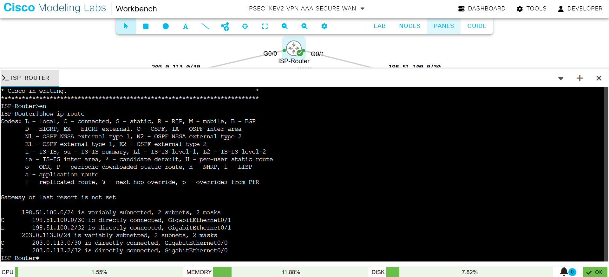
*Figure 2 – ISP-Router holds only its two connected /30 links. There is no route to 10.10.10.0/24 or 10.20.20.0/24, so the sites can only talk through the VPN.*

### Phase 2 · IKEv2/IPsec tunnel

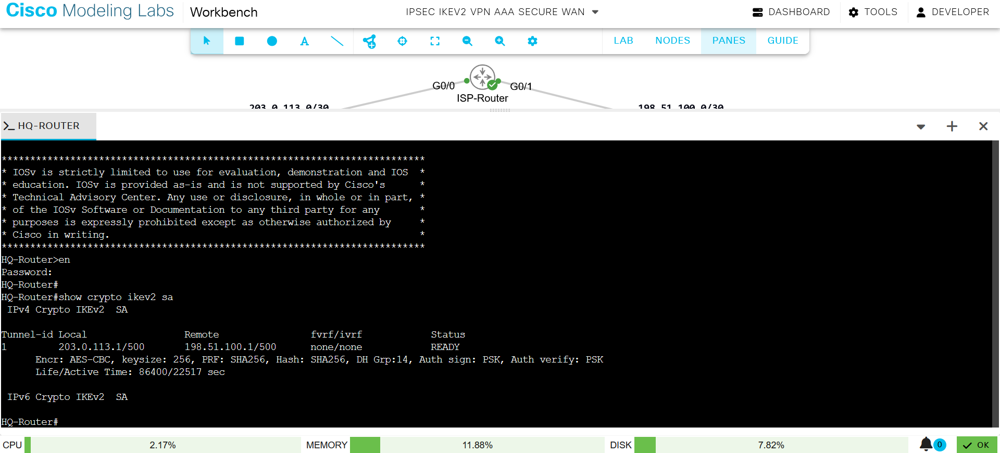
*Figure 3 – HQ-Router: IKEv2 SA is `READY` (AES-CBC-256, SHA-256, DH group 14, PSK).*

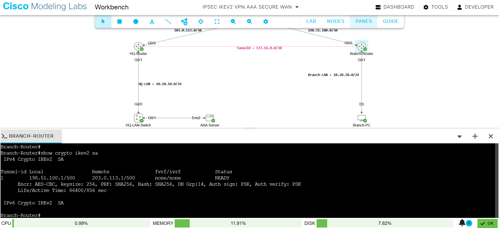
*Figure 4 – Branch-Router: the same SA seen from the other side (local and remote addresses swapped).*

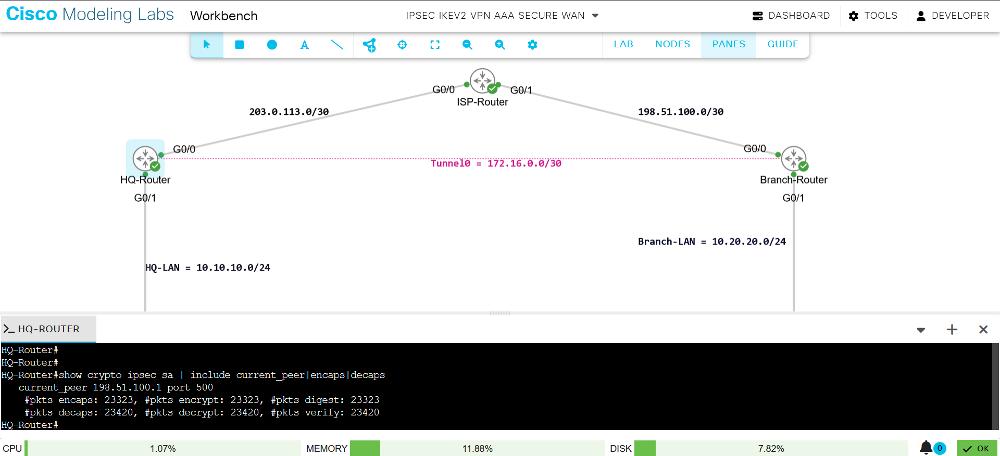
*Figure 5 – Packets are being encrypted and decrypted by the tunnel peer `198.51.100.1` (more than 23,000 in each direction).*

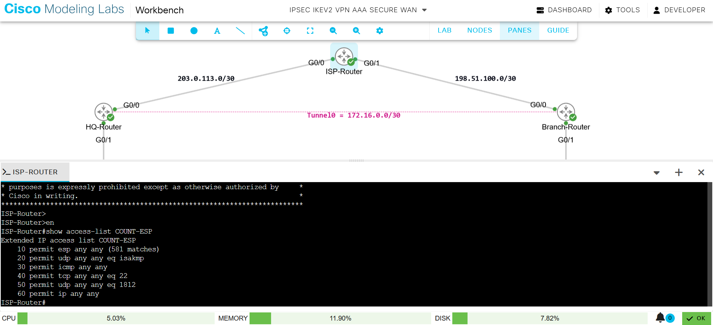
*Figure 6 – A counting ACL on the ISP-Router. Only ESP matches. The ICMP, SSH (TCP 22) and RADIUS (UDP 1812) counters stay at zero while ping, SSH logins and RADIUS traffic are running, which proves they all travel inside the tunnel.*

### Phase 3 · AAA with FreeRADIUS

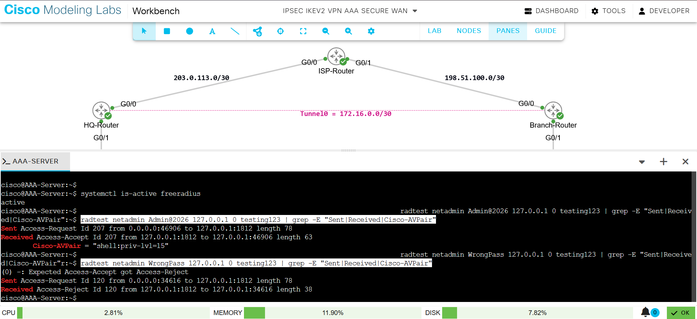
*Figure 7 – The server is active. A valid user gets `Access-Accept` with `shell:priv-lvl=15`. A wrong password gets `Access-Reject`.*

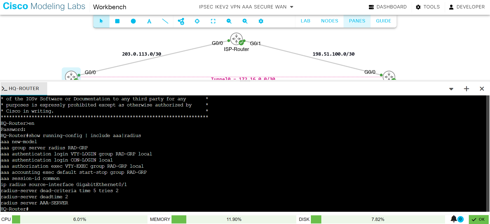
*Figure 8 – HQ-Router AAA configuration: method lists for authentication, authorization and accounting, the RADIUS source interface, and dead-server timers.*

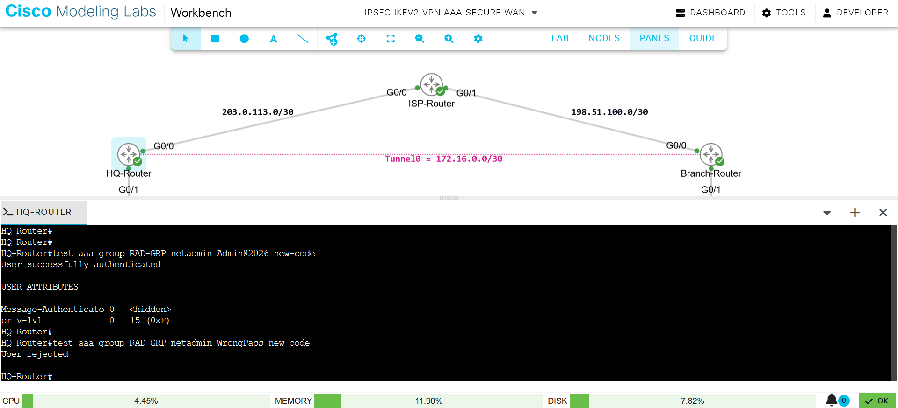
*Figure 9 – `test aaa` from the router: correct password is authenticated (privilege 15 returned), wrong password is rejected.*

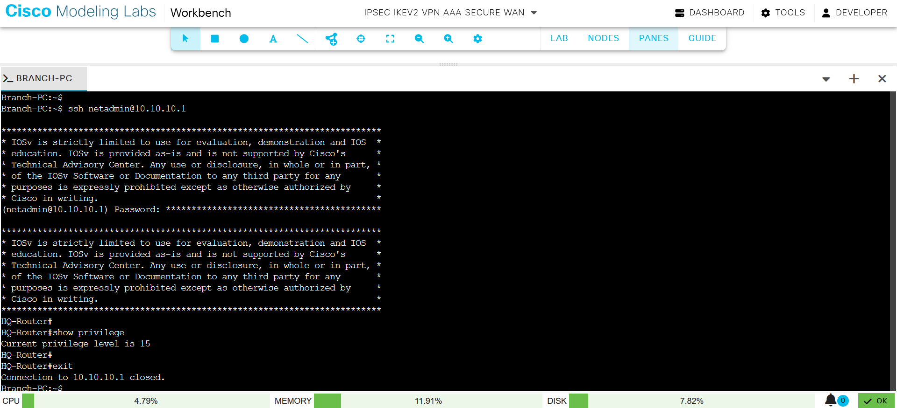
*Figure 10 – SSH from Branch-PC through the tunnel as `netadmin`. The router places the user at privilege level 15.*

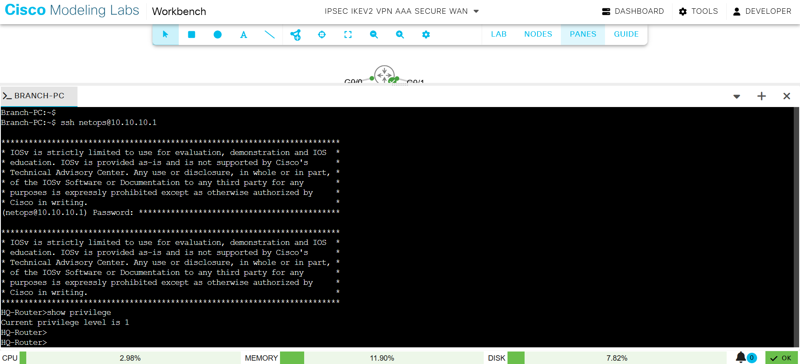
*Figure 11 – SSH as `netops`. The server returns level 1, so the user stays in user EXEC mode and configuration commands are not available.*

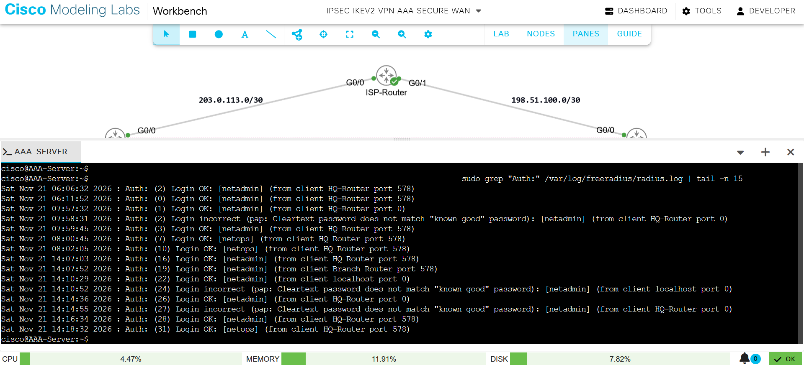
*Figure 12 – Server log: successful logins from both `HQ-Router` and `Branch-Router` (the Branch request crosses the VPN), plus rejected attempts.*

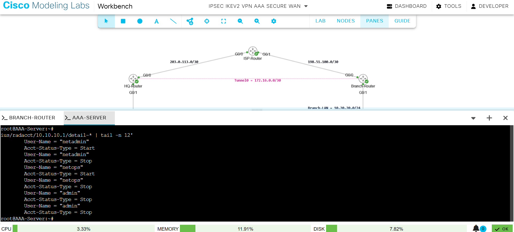
*Figure 13 – Accounting records on the server: a Start and a Stop record for each login session with user name.*

### Phase 4 · Failure and recovery tests

**Test A: the RADIUS server stops**

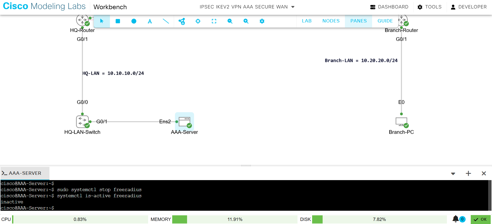
*Figure 14 – FreeRADIUS is stopped (`inactive`).*

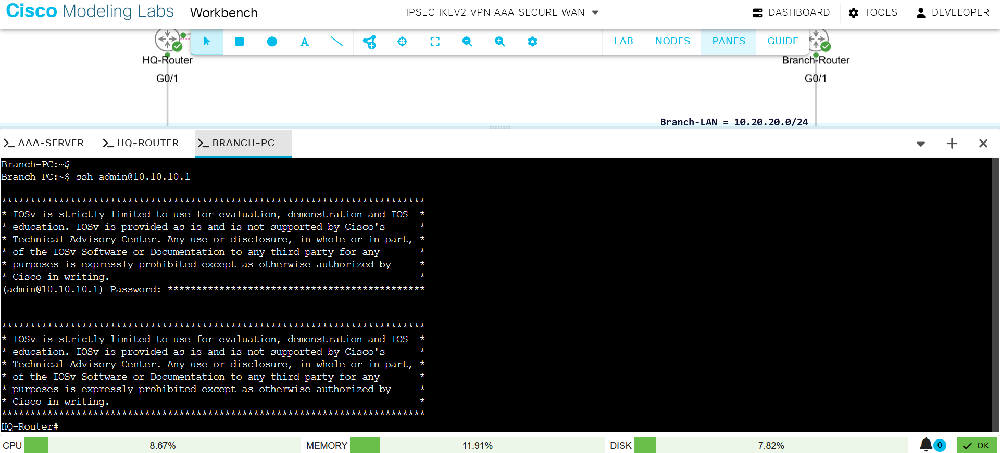
*Figure 15 – The local `admin` user still logs in to HQ-Router over SSH.*

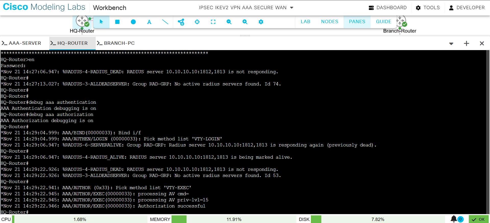
*Figure 16 – Debug output: the router declares the server dead, finds no active RADIUS servers, uses the local method, and authorization succeeds at level 15.*

**Test B: the tunnel goes down**

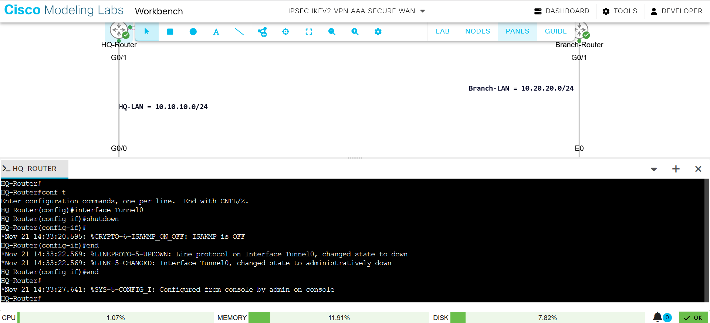
*Figure 17 – `Tunnel0` is shut down: ISAKMP goes off and the line protocol drops.*

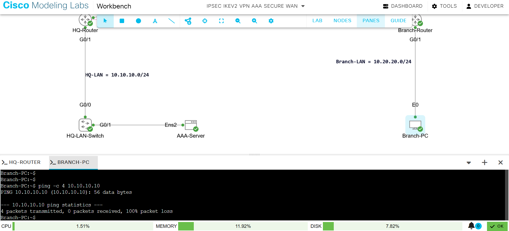
*Figure 18 – With the tunnel down, Branch-PC cannot reach the HQ LAN (100% packet loss). The ISP has no route to it.*

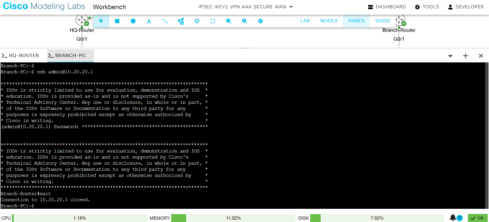
*Figure 19 – The Branch-Router is still manageable: the RADIUS server is unreachable, so it falls back to the local `admin` user.*

**Recovery**

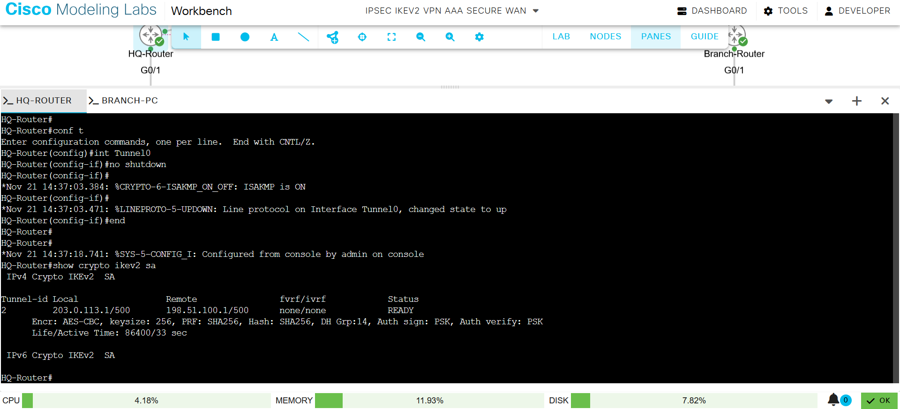
*Figure 20 – `no shutdown`: ISAKMP comes back and a new IKEv2 SA (tunnel-id 2) reaches `READY` by itself.*

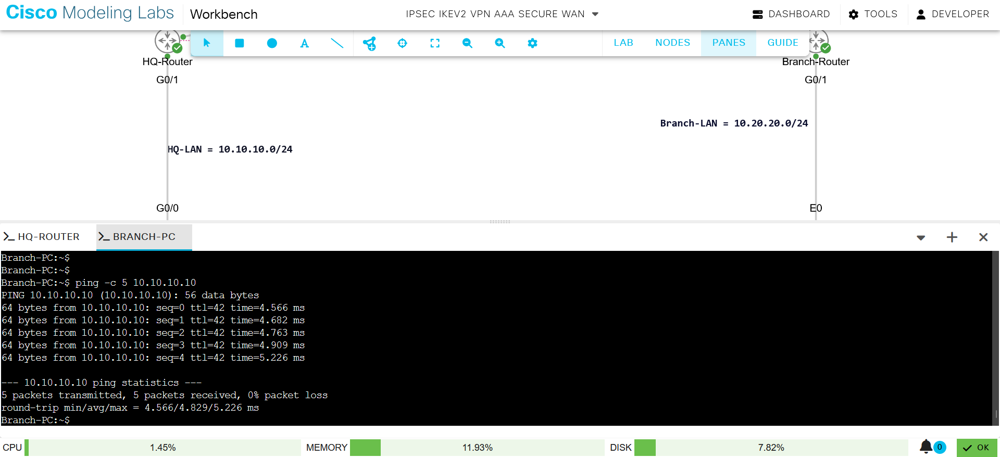
*Figure 21 – Branch-PC reaches the AAA-Server again through the tunnel (0% loss).*

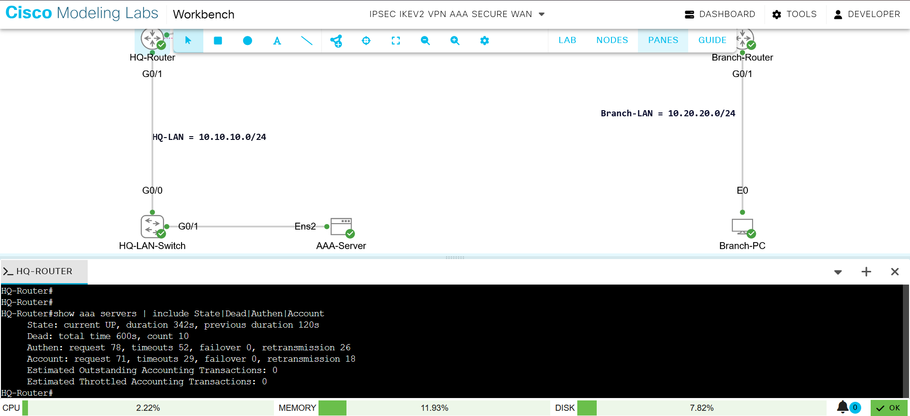
*Figure 22 – RADIUS server statistics on HQ-Router: the server is `UP` again, and the dead-server count and request timeouts show that the router noticed the outages.*

---

## ✅ Test results

| # | Test | Expected | Result | Evidence |
|---|---|---|---|---|
| 1 | ISP route table | No private networks on the ISP | ✅ Pass | Fig. 2 |
| 2 | IKEv2 SA on both gateways | `READY` | ✅ Pass | Fig. 3, 4 |
| 3 | Traffic through the tunnel | Encaps and decaps counters rise | ✅ Pass | Fig. 5 |
| 4 | What the ISP sees | Only ESP, no ICMP, SSH or RADIUS | ✅ Pass | Fig. 6 |
| 5 | RADIUS accept and reject | Valid user accepted, wrong password rejected | ✅ Pass | Fig. 7, 9 |
| 6 | Privilege from the server | `netadmin` = 15, `netops` = 1 | ✅ Pass | Fig. 10, 11 |
| 7 | Logging and accounting | Login result and Start/Stop records on the server | ✅ Pass | Fig. 12, 13 |
| 8 | RADIUS server down | Local `admin` still logs in | ✅ Pass | Fig. 14–16 |
| 9 | Tunnel down | Sites isolated, Branch still manageable locally | ✅ Pass | Fig. 17–19 |
| 10 | Recovery | New IKEv2 SA and full reachability without manual clearing | ✅ Pass | Fig. 20–22 |

---

## 🛠️ Troubleshooting log

| Problem | Cause | Fix |
|---|---|---|
| `radius server` command rejected | The command only exists after `aaa new-model` | Enter `aaa new-model` first, then the RADIUS block |
| AAA server could not install packages | The lab has no internet access | Attached a temporary NAT External Connector, installed the packages, then removed it |
| `apt` name lookups timed out | DNS settings forced on the NAT interface | Went back to the DNS handed out by the NAT gateway |
| TACACS+ server package not available | It was not found in the Ubuntu 24.04 repositories on this node | Used FreeRADIUS, which gives the same AAA functions for device login |
| SSH to IOSv failed with "no matching key exchange method" | IOSv offers only older SSH algorithms | Added `KexAlgorithms +diffie-hellman-group14-sha1` and `HostKeyAlgorithms +ssh-rsa` to the client SSH config |
| Logins hung and the router log flapped DEAD/ALIVE | Default dead-server timers made every login wait for the full timeout | Added `radius-server dead-criteria time 5 tries 2` and `deadtime 2` |
| `netops` showed privilege 15 | The tester typed `enable`, and the enable secret raised the level | Verified level 1 before using `enable` (see limitations) |

---

## ⚠️ Known limitations & next steps

- **BlastRADIUS warnings:** the FreeRADIUS log warns that IOSv does not send a `Message-Authenticator`. This is acceptable in an isolated lab, but production devices should run software that supports it.
- **Enable secret is local:** anyone who knows it can raise a level-1 session to level 15. A production design would use `aaa authentication enable` with the AAA server.
- **RADIUS has no per-command control:** command authorization and command accounting need TACACS+.
- **Single AAA server:** a second server would remove the single point of failure (local fallback is the safety net here).
- **Pre-shared key:** certificates (PKI) would scale better and avoid shared secrets.
- **Static routing over the VTI:** a dynamic routing protocol would be the next step for more than two sites.
- **Planned follow-ups:** a dedicated AAA lab (TACACS+ and RADIUS) and an Active Directory integration lab.

---

## 🎯 Skills demonstrated

`IPsec` · `IKEv2` · `Route-based VPN (VTI)` · `AAA` · `RADIUS` · `FreeRADIUS` · `Privilege levels` · `Cisco IOS` · `SSH hardening` · `Failover testing` · `Troubleshooting` · `Linux administration` · `Cisco CML`

---

## 📂 Repository structure

```text
.
├── README.md
└── images/
    ├── 01-topology.png
    ├── 02-isp-route-table.png
    ├── ...
    └── 22-aaa-server-stats.png
```

The configurations live inside the CML lab and are summarised above with secrets removed, so this repository holds the documentation and evidence only.

<div align="center">

<sub>Built and documented by Soweto · November 2026</sub>


</div>
